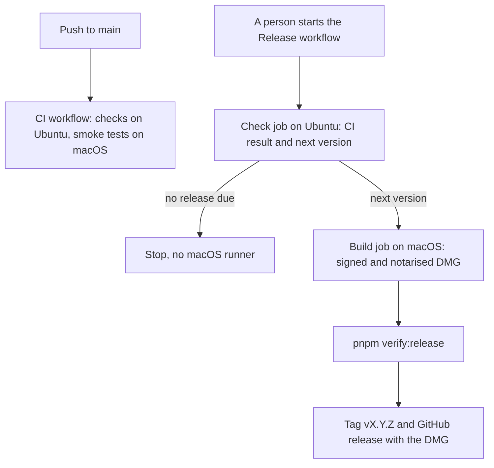

<div align="center"></div>

<h1 align="center">Bifrost</h1>

<div align="center">

[](https://github.com/Keane54/bifrost/actions/workflows/ci.yml) [](https://github.com/Keane54/bifrost/actions/workflows/release.yml)

[](https://www.electronjs.org/)
[](https://react.dev/)
[](https://www.typescriptlang.org/)
[](https://tailwindcss.com/)
[](https://vite.dev/)
[](https://xtermjs.org/)

[](https://pnpm.io/)
[](https://biomejs.dev/)
[](https://vitest.dev/)
[](https://playwright.dev/)
[](https://www.conventionalcommits.org/)
[](https://github.com/semantic-release/semantic-release)

</div>

Bifrost is a macOS desktop app for Claude Code. It shows all the Claude Code sessions on your Mac in one window, and it lets you control them.

Bifrost has a modular, flexible interface. Panels float inside one app window. You can move, resize, snap and stack the panels, plus save each layout with a name to load it again later.

Built with [Electron](https://www.electronjs.org/), [React](https://react.dev/) and [TypeScript](https://www.typescriptlang.org/), with:

- [electron-vite](https://electron-vite.org/) (build) and [electron-builder](https://www.electron.build/) (DMG)
- [xterm.js](https://xtermjs.org/) and [node-pty](https://github.com/microsoft/node-pty) (chat windows)
- [Tailwind CSS v4](https://tailwindcss.com/) (styles)
- [Base UI](https://base-ui.com/) (menus, dialogs and tooltips)
- [TanStack Table](https://tanstack.com/table/latest) and [TanStack Hotkeys](https://tanstack.com/hotkeys/latest) (Overview columns and keys)
- [Biome](https://biomejs.dev/) (lint and format)
- [Vitest](https://vitest.dev/) (unit tests) and [Playwright](https://playwright.dev/) (smoke tests)

## What Bifrost does

- Bifrost reads the session list from `claude agents --json` every 2 seconds.
- It starts a new session in the background with `claude --bg`.
- Each chat window shows the real terminal interface of Claude Code for one session. Bifrost runs `claude attach` for this.
- A session that a terminal app owns, for example Warp, shows its status only. With the Take control action, you can move the session to the background service of Claude Code.
- A yellow box or a red box flashes on a session that needs you. A macOS notification and a sound are optional.
- Live details is an optional mod for Claude Code. It sends live events and usage data to Bifrost. Then Bifrost shows the model, the cost and the context use of each session. Bifrost asks about Live details at the first start.

## Panels

The side bar on the left edge has one button for each panel. It also holds the panels that you minimise.

| Panel | Content |
| --- | --- |
| Overview | The list of sessions. Each tab has its own filters, columns and sort order. You can open more than one Overview. |
| Selected Item | The selected session, its action buttons and a send box. |
| Chat window | The Claude Code terminal of one session. |
| Show Info | All the details of one session. |
| Watchlist | The sessions that you track, in your order and colours. |
| Event log | The live events of the sessions, with their times. |
| Usage HUD | The use of the 5-hour limit and the 7-day limit. |
| Service status | The status of Claude, GitHub and Sentry. |
| Reviews | The GitHub pull requests that need you, in two tabs: To review and My PRs. In this version, the panel only shows the pull requests. |
| Settings | The tabs General, Slash commands, Keys, Reviews and Live details. |

## Requirements

- A Mac with Apple silicon and macOS 13 or later. The DMG has arm64 code only.
- The Claude Code CLI (`claude`). Bifrost finds it through the PATH of your login shell. For Live details, you need Claude Code 2.1.290 or later.
- The GitHub CLI (`gh`) for the Reviews panel. Log in with `gh auth login`.

## Install

1. Download [Bifrost for Apple silicon](https://github.com/Keane54/bifrost/releases/latest/download/Bifrost-arm64.dmg) from the latest release. You must be signed in to GitHub with access to this repository. The [Releases page](https://github.com/Keane54/bifrost/releases) has all versions and their release notes.
2. Open the DMG.
3. Drag Bifrost to the Applications folder.
4. Open Bifrost from the Applications folder.
5. At the first start, Bifrost shows the "Set up Bifrost" dialog. Follow its steps, or select Skip.

## Development

You need Node.js 24 or later and pnpm 12. The `packageManager` field in `package.json` sets the pnpm version.

```bash
pnpm install     # Install the packages, get Electron and build node-pty for Electron
pnpm dev         # Start Bifrost from the repository
pnpm test        # Run the unit tests (Vitest)
pnpm smoke       # Build Bifrost and run the smoke tests (Playwright)
pnpm check       # Run the Biome lint and format checks
pnpm typecheck   # Check the types
pnpm dist        # Make the arm64 DMG in dist/
```

- `pnpm dev` uses your real home folder. So it shows your real sessions.
- For the smoke tests, Bifrost starts with a fake `claude`, a fake `gh` and a test home. The tests do not use your real sessions or your GitHub account.
- `pnpm check:write` corrects the format and the lint problems that Biome can correct.
- Run `pnpm smoke` before you make a DMG.

## Commits

- Write each commit message in the [Conventional Commits](https://www.conventionalcommits.org/) format, for example `fix(chat): show a scroll bar in chat windows`.
- Keep each line of the commit body at 100 characters or less.
- Write the PR title in the same format. The PR Title workflow checks it.
- Write the docs, the code comments and the commit bodies in ASD-STE100 Simplified Technical English. See [CLAUDE.md](CLAUDE.md).

`pnpm install` installs two git hooks with [lefthook](https://lefthook.dev/):

- `pre-commit`: Biome checks and corrects the staged files.
- `commit-msg`: commitlint checks the commit message.

The commit type sets the next version:

| Commit | Next version |
| --- | --- |
| `feat` | Minor, for example 0.1.0 to 0.2.0. |
| `fix`, `perf`, `revert`, `docs`, `style`, `chore`, `refactor`, `test`, `build` or `ci` | Patch, for example 0.1.0 to 0.1.1. |
| A breaking change (`feat!:` or a `BREAKING CHANGE:` footer) | Minor while the version is below 1.0.0. The change to 1.0.0 is a manual step. |

<details>
<summary><b>Release flow</b></summary>



CI runs on each push to `main` and on each pull request. A release runs only when a person starts it, so one release can hold many commits.

1. Start the release: open **Actions > Release > Run workflow** on `main`, or run `gh workflow run release.yml`. Select the mode `release` or `dry-run`.
2. The check job runs on Ubuntu. It stops if CI has not passed for the last commit on `main`. Then semantic-release reads the commits since the last tag and calculates the next version. If no commit needs a release, the run stops here.
3. The build job runs on macOS in the `release` environment. This environment holds the signing secrets, and only `main` can use it.
4. semantic-release sets the version in `package.json` and runs `pnpm dist:release`. This build uses `electron-builder.release.yml`: the Developer ID signature, the hardened runtime and the notarisation. The change to `package.json` stays on the runner.
5. `pnpm verify:release` checks the signature, the hardened runtime and the stapled notarisation ticket. A failed check stops the release.
6. semantic-release pushes the tag `v<version>` and makes the GitHub release with the release notes and the DMG.

The `dry-run` mode does steps 2 to 5 and keeps the DMG as a workflow download for 7 days. It makes no tag and no release.

`pnpm dist` makes a local DMG with no Developer ID signature and no notarisation.

</details>

## Documentation

The [`docs`](docs) folder has the other documents:

- [Electron, Tauri or GPUI](docs/electron-or-tauri.md): why Bifrost stays on Electron.
- [Slack app](docs/slack/README.md): the Slack app for a later milestone.
