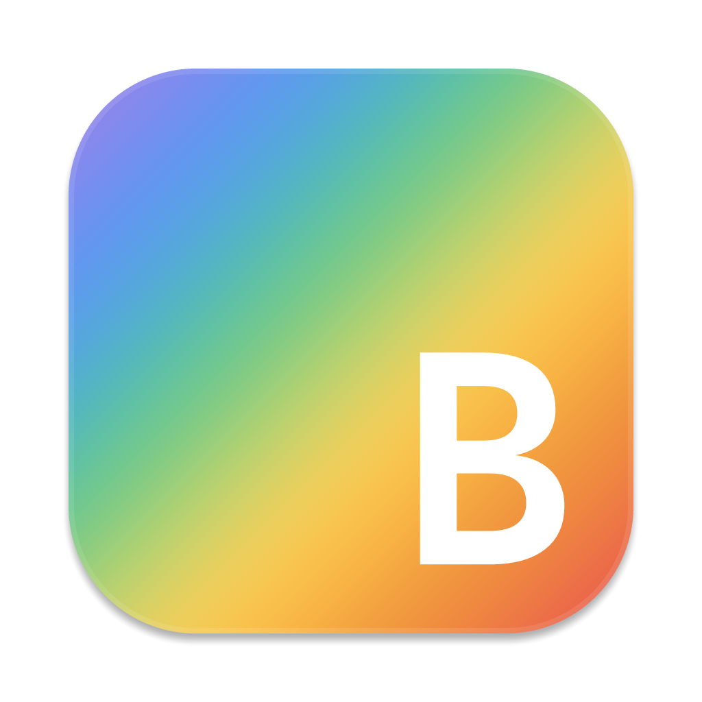

<h1 align="center">Bifrost</h1>

[![CI][ci-badge]][ci] [![Release][release-badge]][release]

[![Swift][swift-badge]][swift] [![SwiftUI][swiftui-badge]][swiftui]
[![AppKit][appkit-badge]][appkit] [![SwiftTerm][swiftterm-badge]][swiftterm]
[![Sparkle][sparkle-badge]][sparkle]

[![Conventional Commits][cc-badge]][cc] [![semantic-release][sr-badge]][sr]

[ci-badge]: https://github.com/Keane54/bifrost/actions/workflows/ci.yml/badge.svg?branch=main
[ci]: https://github.com/Keane54/bifrost/actions/workflows/ci.yml
[release-badge]: https://github.com/Keane54/bifrost/actions/workflows/release.yml/badge.svg
[release]: https://github.com/Keane54/bifrost/actions/workflows/release.yml
[swift-badge]: https://shieldcn.dev/badge/Swift.svg?size=xs&logo=swift&logoColor=ffffff&color=f05138
[swift]: https://www.swift.org/
[swiftui-badge]: https://shieldcn.dev/badge/SwiftUI.svg?size=xs&color=0a84ff
[swiftui]: https://developer.apple.com/xcode/swiftui/
[appkit-badge]: https://shieldcn.dev/badge/AppKit.svg?size=xs&color=262626
[appkit]: https://developer.apple.com/documentation/appkit
[swiftterm-badge]: https://shieldcn.dev/badge/SwiftTerm.svg?size=xs&color=262626
[swiftterm]: https://github.com/migueldeicaza/SwiftTerm
[sparkle-badge]: https://shieldcn.dev/badge/Sparkle.svg?size=xs&color=262626
[sparkle]: https://sparkle-project.org/
[cc-badge]: https://shieldcn.dev/badge/Conventional_Commits.svg?size=xs&logo=conventionalcommits&logoColor=ffffff&gradient=fe5196%2C+f77062
[cc]: https://www.conventionalcommits.org/
[sr-badge]: https://shieldcn.dev/badge/semantic--release.svg?size=xs&logo=semanticrelease&logoColor=ffffff&color=494949
[sr]: https://github.com/semantic-release/semantic-release
[dmg]: https://github.com/Keane54/bifrost/releases/latest/download/Bifrost-arm64.dmg

Bifrost is a native macOS app for Claude Code. It shows every Claude Code session on your Mac in
one window, and you can run them all from there. Panels float inside the window, and you can move,
resize, snap and stack them, then save the layout by name.

## What it does

- Lists your sessions and keeps the list up to date every couple of seconds.
- Starts new sessions in the background. Each chat window is the real Claude Code terminal of a
  session.
- Takes control of a session that runs in another terminal app, such as Warp.
- Flashes a session that needs you, with an optional notification and sound.
- Shows each session's model and context use (with the optional Live details mod), and your 5-hour
  and 7-day limits.
- Hands a session's work over to a fresh session.
- Watches your GitHub pull requests. Claude drafts reviews, answers comments on your own PRs and
  resolves merge conflicts, and you decide what goes out.
- Drafts your daily team update.
- Lets you dictate into a chat: hold Space and talk.

## Requirements

- A Mac with Apple silicon and macOS 26 or later.
- The Claude Code CLI (`claude`), on the PATH of your login shell.
- The GitHub CLI (`gh`) for Reviews, logged in with `gh auth login -s workflow`, so that
  Bifrost can push a merge that changes a workflow file.

## Install

1. Download [Bifrost for Apple silicon][dmg] from the
   [latest release](https://github.com/Keane54/bifrost/releases).
2. Open the DMG and drag Bifrost to Applications.
3. Open Bifrost. The setup dialog walks you through the rest.

Bifrost updates itself after that, and you can turn automatic checks off in Settings > Updates. If
you used the Electron version, it updates to this one by itself and keeps your layouts and
settings.

## Build and test

You need Xcode 26.6 or later. On a new Mac, also install the Metal Toolchain once:

    xcodebuild -downloadComponent MetalToolchain

Before each commit, run the same check as CI:

    scripts/check.sh

Run any other test through the test sandbox, which keeps tests away from your real Claude Code
files, the network and the Keychain:

    scripts/run-sandboxed.sh swift test --package-path Packages/Bifrost \
        --scratch-path .build/pkg --disable-sandbox --filter Shared

Tests never touch a real Claude session. They use the fake `claude` in `scripts/fake-claude/`.

## Running the app

Run only the Debug app. Open `Bifrost.xcodeproj` and build the `Bifrost` scheme, which makes
`Bifrost Dev.app`. It keeps its data apart from the released app. Never start the Release build:
CI builds releases, as [`docs/release.md`](docs/release.md) explains.

The session actions run the real `claude` on your real sessions, so try them on sessions named
`bifrost-test-...` first.

## Repo layout

| Path | What |
| --- | --- |
| `App/Bifrost/` | The app target. `Resources/` holds the Live details mod and the skills that the app bundles |
| `Packages/Bifrost/` | The Swift package, with one module for each area of the app |
| `Config/` | Build settings and the Debug app's Info.plist |
| `scripts/` | The check script, the test sandbox, the smoke test and the fake `claude` and `gh` |
| `tools/bench/` | The performance bench |

## Docs

- [`docs/behaviour/`](docs/behaviour/) says what each feature does, in detail.
- The explainer pages show how the biggest parts fit together:
  [canvas and panels](docs/explainers/canvas-and-panels.html),
  [sessions and attach](docs/explainers/sessions-and-attach.html),
  [keyboard input](docs/explainers/keyboard-input.html),
  [Live details and skills](docs/explainers/live-and-skills.html) and
  [Reviews](docs/explainers/reviews.html).
- [`docs/release.md`](docs/release.md) explains releases.
- [`docs/WRITING.md`](docs/WRITING.md) explains how to write the docs.
