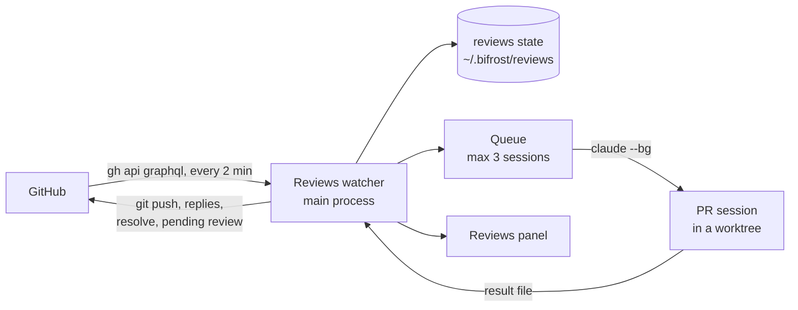

# Bifrost Reviews: design

Status: approved by the user, 2026-11-09. R1 built.

The Reviews panel shows the GitHub pull requests (PRs) that need you. It has two tabs:

- **To review**: the PRs where a person asks for your review.
- **My PRs**: the PRs that you opened.

Bifrost watches these PRs in the background. On your own PRs, Claude handles the review comments automatically. On the PRs of other people, Claude writes an adversarial review, but only after you click Review.

This design depends on the voice project (`write-as-me`), which has its own design. Bifrost builds the voice first.

## 1. Intent

The user gets review requests and review comments across many repositories. Today he finds them by hand, starts Claude by hand, and copies the results to GitHub by hand.

The Reviews panel does three things:

1. It shows in one place what needs you on GitHub.
2. It fixes or answers the comments on your own PRs without your input. It asks you only when a comment needs your decision.
3. It starts a careful review of another person's PR when you ask for it. The result is a draft review that only you can see until you submit it.

Bifrost is used inside the company, on the repositories of the company organisation. The rules about outsiders (sections 5, 6 and 10.2) protect a person who uses Bifrost on open-source repositories.

The user prefers deterministic code to a Claude orchestrator. So plain code in the Bifrost main process watches GitHub, queues the work and starts the Claude sessions. Claude does only the work that needs judgment.

## 2. Goals

- Show the PRs that need you, sorted so that the most urgent row is at the top.
- Flash a new review request until you act on it.
- Handle the comments on your own PRs automatically: fix, reply, resolve.
- Make the token cost predictable. A review starts only on a click. Claude handles Copilot only one time for each PR.
- Keep every write to GitHub inside Bifrost code, where tests can check it.

## 3. Non-goals

- Claude does not fix failing CI checks. The row only shows a failed-check icon.
- Bifrost does not merge, approve or request changes on any PR.
- Bifrost does not watch GitHub while Bifrost is closed. At the next start, it catches up.
- No GitHub App, no webhooks and no OAuth screen. Bifrost uses the `gh` CLI login.
- github.com only. GitHub Enterprise Server is not in scope.
- A PR row does not change the Selected Item panel.
- No Claude session that coordinates other sessions.

## 4. Anti-goals

The design fails if any of these occurs, even when the code works:

- Bifrost posts text on another person's PR before you see it.
- Claude and Copilot start a loop of automatic rounds on one PR.
- Bifrost changes a checkout of yours, for example in `~/Developer`.
- Bifrost uses tokens without a clear cause. Examples: a review without your click, or a round for a comment that Bifrost handled before.
- Claude acts on a comment from a person outside the repository.
- Bifrost accepts a workspace trust prompt for you.

## 5. Terms

| Term | Meaning |
|---|---|
| Request session | The Claude session that handles the comments on one of your PRs. Name: `{repo}-{number}-request`. |
| Review session | The Claude session that reviews another person's PR. Name: `{repo}-{number}-review`. |
| PR session | A request session or a review session. |
| Thread | A review comment on a line of code, with its replies. GitHub can resolve a thread. |
| Top-level comment | A review summary or a PR comment. GitHub cannot resolve it. |
| Trusted author | A person whose GitHub `authorAssociation` on the repository is `OWNER`, `MEMBER` or `COLLABORATOR`, or Copilot. You are never a trusted author of comments on your own PR. |
| Pending review | A GitHub review that is not submitted. Only its author can see it. |
| Round | One run of a PR session on a set of threads and comments. |

## 6. Architecture

| Part | Role |
|---|---|
| Reviews watcher | Main-process code. It polls GitHub, computes each status, selects the work, keeps the state, and does every write to GitHub. |
| Queue | Starts PR sessions, at most N at one time. |
| Repo store | Bifrost's own clone of each repository, and one worktree for each PR. |
| PR session | A normal Bifrost-owned background session. It reads an input file, changes code, commits on its local branch, and writes a result file. It does not write to GitHub. |
| Skills | `pr-resolve-comments` and `adversarial-review`. They hold the judgment rules. |
| Reviews panel | The renderer panel with the two tabs. |

Decision (my call): **only Bifrost code writes to GitHub.** The PR session never pushes and never calls a GitHub write API. Reasons:

- Each write is plain code with tests.
- A PR can contain text that tries to give Claude instructions. With no write access, such text cannot make Claude post or push.
- Bifrost can check each push before it sends it.

Claude Code enforces this rule. A prompt or a deny list alone is not sufficient:

| Session | Enforcement |
|---|---|
| Review session | `--restricted` and `--strict-mcp-config` (my call). Claude has no shell and no code-running tools, so it cannot run PR code, `gh`, `git` or `curl`. The mode ignores the settings, hooks and MCP servers of the PR head, so a PR from an outsider cannot run code as you. The file tools stay inside the worktree. Restricted mode keeps `EnterWorktree`, `Agent` and `WebSearch`, so the start also passes `--disallowedTools EnterWorktree Agent` (spike, 2026-11-09). |
| Request session | The Claude Code sandbox, with no network access to GitHub (user decision, 2026-11-09). The escape from the sandbox (`allowUnsandboxedCommands`) is off. A deny list for `git push`, `gh` and `WebFetch` is a second layer. |

## 7. GitHub data

Bifrost runs `gh` the same way it runs `claude`: with the login-shell `PATH` and a clean environment. It reads no token itself.

Each poll runs GraphQL queries for two lists:

| List | Search |
|---|---|
| To review | `is:pr is:open review-requested:@me archived:false` |
| My PRs | `is:pr is:open author:@me archived:false` |

For each PR, the query reads:

- the repository, number, title, URL, author, draft flag, additions, deletions, created and updated times;
- the open review requests: users and teams, so Bifrost can tell a direct request from a team request;
- the reviews: author, `authorAssociation`, state, submitted time, commit;
- the review threads: ID, `isResolved`, path, line, and each comment with its author, `authorAssociation`, body and time;
- the top-level comments, with the same fields;
- the status check rollup of the head commit;
- the head branch, the head repository and the head commit.

The poll interval is 2 minutes. A manual Refresh button in the panel polls at once. When `gh` is missing or not logged in, the panel shows a friendly message that tells you to run `gh auth login`. Facts from the spike of 2026-11-09:

- In GraphQL, Copilot is `__typename` `Bot` with the login `copilot-pull-request-reviewer` and the `authorAssociation` `NONE`, for reviews and for thread comments. In REST, a review author is `copilot-pull-request-reviewer[bot]` and a thread comment author is `Copilot`.
- `requestedReviewer.__typename` is `User` (with `login`) or `Team` (with `slug`).
- A full query for 20 PRs costs 11 GraphQL points.

Merged and closed PRs never show, because both searches use `is:open`. GitHub keeps your request on merged PRs: on 2026-11-09, 489 merged PRs still listed you as a requested reviewer.

## 8. To review tab

### 8.1 Rows

Each PR uses two lines (the user chose layout B):

- Line 1: the repository, `#number`, the title. A `team` tag follows the title for a team request.
- Line 2: the author, `+additions −deletions`, the age, and on the right the state or the buttons.

### 8.2 States and order

| Order | State | Right side of line 2 | Flash |
|---|---|---|---|
| 1 | New request: a direct request that arrived after the first turn-on, with no session and no pause | Review, Pause | Yes |
| 2 | Draft ready: the pending review exists | "Draft ready" | No |
| 3 | Waiting for you: a direct request that was open at the first turn-on | Review | No |
| 4 | Reviewing or Queued | "Reviewing" or "Queued" | No |
| 5 | Paused | "Paused 42m" (the time left) | No |
| 6 | Approved by others: the GitHub `reviewDecision` is `APPROVED` | Review | No |
| 7 | Team request | Review | No |

Inside a group, the oldest request comes first. Paused rows: the first to end comes first.

Rules for the flash:

- At the first turn-on, the requests that are open do not flash (user decision, 2026-11-09). Only a request that arrives after the turn-on flashes.
- A request is new when the PR was not in the list at the last poll. So a request that you finish, and that the author makes again, flashes.
- A PR whose `reviewDecision` is `APPROVED` does not flash (my call). The required approvals are complete, so your approval changes nothing. This follows the user's rule for merged PRs. A PR with no required reviews has no `reviewDecision`, and it flashes as usual.

### 8.3 The flash

- The whole row background pulses red. It is stronger than the red box of the Overview. It uses `--color-box-red`.
- The tab count is red while one or more rows flash.
- The Row flash setting (section 10 of the main spec) also stops this flash.

### 8.4 Review and Pause

- **Review** starts a review session (section 11). The row goes to Queued or Reviewing.
- **Pause** stops the flash for the pause time (setting, default 1 hour). When the pause ends, the row flashes again.
- Pauses survive a restart of Bifrost.
- A row leaves the tab when GitHub no longer requests your review, for example after you submit your review.
- If the author asks for your review again, the row comes back as a new request and flashes.

## 9. My PRs tab

### 9.1 Rows

- Line 1: the repository, `#number`, the title, then a red ✕ when one or more checks of the head commit failed. Hover on the ✕ shows how many checks failed.
- Line 2, from left to right:
  - the review status: a colour dot and a word;
  - the reviewers;
  - the count of later Copilot comments, if any, for example "Copilot: 3 more";
  - on the right, the Claude state.

### 9.2 Review status

Bifrost computes the status from the latest review of each human reviewer. Copilot never counts as a reviewer for this rule. The first match wins:

| Status | Rule |
|---|---|
| Changes requested | The latest review of one or more human reviewers is `CHANGES_REQUESTED`. |
| Comments | One or more threads from trusted authors or from the first Copilot review are not resolved. Unresolved threads from before the first turn-on count too. |
| Approved | One or more human reviewers approved, and no thread is open. |
| Pending | Any other case, also when no reviewer is requested. |

Only threads count for Comments. A review body or a top-level comment does not change the status. It stays work for the request session (section 10.2). So a "Thanks" comment does not hide an approval.

Copilot comments can make a PR show Comments. Copilot can never make a PR Approved.

### 9.3 Claude state

| State | Meaning |
|---|---|
| Needs you | The request session has a red box. Same red box as the Overview. |
| Fixing N | The session works on N threads and comments. |
| Queued | The work waits for a free session slot. |
| Trust needed | The repository clone is not trusted yet (section 12.2). |
| Cloning | Bifrost clones the repository for the first time. |
| Waiting | Nothing to do. |
| Error | The last round failed. Hover shows the cause. |

### 9.4 Order

1. Needs you
2. Changes requested
3. Comments
4. Pending
5. Approved

Inside a group, the last update comes first.

## 10. Request sessions (your PRs)

### 10.1 When a round starts

A round starts automatically when a poll finds new work (section 10.2) on one of your PRs and the PR has no running round. Draft PRs count too.

First turn-on (user decision, 2026-11-09): Bifrost marks all existing threads and comments as seen. Only work that arrives after the turn-on starts a round. A row with older open items shows their count, and its menu has "Handle now", which starts one round on them. The review requests that are open at the first turn-on do not flash (section 8.2).

### 10.2 What is work

Bifrost selects these threads and comments, and only when they are not resolved and not handled yet:

- Threads and top-level comments from trusted human authors.
- Threads from the **first** Copilot review of the PR only (user decision, 2026-11-09). Later Copilot reviews start nothing. The row shows their count. The row menu item "Handle Copilot comments" starts one round on them by hand.
- Bifrost ignores the Copilot review summary.
- Bifrost ignores comments from other bots and from outsiders. They still show on GitHub.
- A handled thread is new work again only after a trusted author adds a comment to it. That comment must be newer than the last reply from Bifrost.

### 10.3 What Claude does

Bifrost writes an input file with the selected threads and comments and starts or resumes the session. The `pr-resolve-comments` skill sets the rules. For each item, Claude does one of these:

| Outcome | Claude | Bifrost |
|---|---|---|
| Fixed | Changes the code and commits it on the local PR branch. | Pushes. Replies "Fixed by {short sha}". Resolves the thread. |
| No fix | Writes a reply in your voice that says why no change is necessary. | Posts the reply. Resolves the thread. |
| No action | Nothing. Use: an approval, a "thanks", a note to another person. | Posts nothing. Records the item as handled. |
| Needs you | Asks you with AskUserQuestion. The session gets a red box. | Waits. After your answer, Claude records one of the other outcomes. |

Claude records "Needs you" only for a question that it cannot answer safely. Examples:

- a product or intent decision;
- a requirement that is not in the code;
- a trade-off that you own;
- a request that conflicts with another reviewer.

Results go out at once (my call). Claude handles all other items first and writes their results. Bifrost then pushes and posts them immediately. After that, Claude asks its questions. So one open question does not stop the other fixes, and the replies do not wait for your answer.

Bifrost ignores a review summary with an empty body.

For a top-level comment, Bifrost posts the reply as a new PR comment that quotes the request. It records the comment as handled.

Replies use the `write-as-me` voice. They have no note that Claude wrote them (user decision, 2026-11-09). "Fixed by {short sha}" is a fixed text from Bifrost.

### 10.4 The push

- Claude commits on the local branch of the PR in the worktree. It follows the commit rules of that repository.
- Before the push, Claude runs the checks of the repository when it can find them. If they fail and Claude cannot fix them, it asks you (red box).
- The sandbox blocks GitHub. It allows the package registries in a fixed list, so that installs can work. A check that fails only because the sandbox blocks the network does not stop the push. Claude records it in the result (my call). CI still runs on GitHub.
- Bifrost pushes with `git push origin HEAD:<head branch>`, never with force. Bifrost first checks that the remote head is an ancestor of the local head.
- The remote branch can move before the push. Then GitHub refuses the push. Bifrost tells the session to merge the remote branch, with no rebase. Then Bifrost tries the push one more time. A merge conflict makes Claude ask you.
- Bifrost never pushes to a branch of another person's fork.

### 10.5 After the round

- When all the threads of a human reviewer with `CHANGES_REQUESTED` are resolved, Bifrost asks that reviewer for a new review. It never asks Copilot again (user decision, 2026-11-09).
- Bifrost records each thread and comment as handled, and records the ID and text of each comment that it posted. The voice project reads this list, so it never learns from Claude's own text.

## 11. Review sessions (other people's PRs)

- A review session starts only on a click on Review.
- The session is read-only (section 6). It does not run PR code, so it does not run the tests of the PR. The input file has the PR diff, the base and head commits, and the commit of your last review. The worktree has the PR head, so Claude can read the full files.
- The session uses the `adversarial-review` skill. It reports only actionable problems and places where the intent is unclear. It reports no small style points.
- Claude writes its findings to the result file. The findings are a short summary and a list of comments. Each comment has a path, a line and a body. The text uses your voice.
- Bifrost creates a **pending** review with these comments. Only you can see it. You read it, change it if you want, and submit it in GitHub. Claude never approves or requests changes.
- If you already have a pending review on the PR, Bifrost adds the comments to it.
- The author can ask for your review again. Then the new review covers the changes since the commit of your last submitted review. It also checks that the author fixed your earlier comments.
- Bifrost records the text of each draft comment. The voice project compares it with the text that you submit.

## 12. Repositories and sessions

### 12.1 Repo store

- Bifrost keeps its own clone of each repository in `~/.bifrost/reviews/repos/<owner>/<repo>`. It never uses your checkouts.
- Each PR gets one worktree with the PR head checked out. Bifrost removes the worktree when the PR is merged or closed.
- Clones stay. A Settings button removes all clones.

### 12.2 Workspace trust

`claude --bg` refuses a directory that is not trusted, and Claude Code keeps trust for each git root (spec section 4). Bifrost never accepts trust for you.

You accept trust one time for each repository. Bifrost brings the prompt to you (user decision, 2026-11-09):

1. **Set up at the first turn-on.** Bifrost finds the repositories of your open PRs and review requests. It clones them and lists the ones that need trust, so you can do all the trust steps at once.
2. **The "Trust needed" strip.** A strip at the top of the Reviews panel shows each repository that needs trust. It also shows the number of PRs that wait for it. A new repository also sends one macOS notification.
3. **The Trust button.** It opens a small Bifrost terminal window that runs `claude` in the clone, so the real trust prompt shows there. You accept the prompt.
4. **The end of the step.** Bifrost reads `~/.claude.json` (read only) to see that trust is accepted. Then it closes the terminal, stops its `claude` process and starts the work that waited.

Other rules:

- The rows of a repository that needs trust show "Trust needed". Their work waits, and it does not block the queue for other repositories.
- Bifrost never writes the trust setting. Every running `claude` process writes `~/.claude.json`, so a write from Bifrost can corrupt the file, and it skips the safety check.
- A worktree of a trusted clone needs no second trust step. This is also true for a worktree outside the clone directory (spike, 2026-11-09).

### 12.3 PR sessions

- A PR session is a normal Bifrost-owned background session. It shows in the Overview.
- Bifrost starts it with `claude --bg` in the worktree. The start adds the statusline override, the session name and the model of its job type. It also loads the Bifrost skills with `--plugin-dir`.
- A review session adds the flags of section 6. A request session adds `--permission-mode auto` and the sandbox settings of section 6, in the same `--settings` value as the statusline override.
- Builder: test the flags of each kind on a `bifrost-test-` session first. Check these points:
  - `--restricted` works with `--bg`;
  - the sandbox works with `--bg`, and the escape from the sandbox is off;
  - the skills load;
  - whether `--restricted` changes the trust check.
- A PR session gets no yellow box and no escalation when a round ends (my call). Only "Needs you" gives a red box, a flash and a notification. This needs a per-session rule in the registry.
- A session stays while its PR is open. Bifrost resumes it and sends the new round to it. Bifrost stops a session that is idle for 10 minutes with no open question. Bifrost removes the session when the PR is merged or closed.
- If two repositories with the same name need a session, Bifrost adds the owner to the name: `{owner}-{repo}-{number}-{kind}`.
- In tests, each session name starts with `bifrost-test-`.

### 12.4 Queue

- At most 3 PR sessions work at one time (setting, from 1 to 10).
- A session that waits for you does not use a slot.
- Queued work starts in order: the oldest first.

## 13. Clicks, menu and notifications

- A click on a row opens the chat window of the PR session. This occurs only while the session runs or needs you. Else a click does nothing (user decision, 2026-11-09).
- Cmd+click opens the PR on GitHub.
- The right-click menu shows only the items that apply to the row. The items are: Open on GitHub, Open session, Review, Pause, End pause now, Handle now, Handle Copilot comments, Stop session.
- A macOS notification shows for three events: a new direct review request, Needs you, and Draft ready. Draft ready is my call. The notification settings of section 10 of the main spec apply.

## 14. Settings

A new "Reviews" section in Settings:

| Setting | Default |
|---|---|
| Watch GitHub | Off. The first turn-on shows what Bifrost will do on GitHub. |
| Handle comments on my PRs automatically | On |
| Show team requests | On |
| Maximum PR sessions | 3 (1 to 10) |
| Pause time | 1 hour |
| GitHub poll interval | 2 minutes |
| Model for request sessions | Your Claude Code default |
| Model for review sessions | Your Claude Code default |
| Repositories to ignore | Empty. A list of `owner/repo` or `owner/*`. |
| Remove all clones | A button |

The Settings search finds these rows (main spec section 12).

## 15. State

Bifrost keeps the Reviews state in `~/.bifrost/reviews/state.json`:

- the time of the first turn-on, and the IDs of the items that were open then;
- for each PR:
  - the session names and IDs;
  - the pause end;
  - the first Copilot review ID;
  - the handled thread and comment IDs;
  - the last reviewed commit;
- the comments that Bifrost posted, with ID and text;
- the draft review comments, with ID and text.

The state survives a restart. Tests use a test home, never the real `~/.bifrost`.

## 16. Skills

Bifrost ships the two skills in a plugin folder. PR sessions load that folder with `--plugin-dir`, so the skill version always matches Bifrost. You can also run the skills by hand:

| Skill | Purpose |
|---|---|
| `pr-resolve-comments` | Adapted from `pr-review-comments`. Decides Fixed, No fix or Needs you for each item, and fixes the code. With a result file from Bifrost, it writes results there. By hand, with no result file, it reports in the chat. |
| `adversarial-review` | Reviews a PR for actionable problems and unclear intent only. With a result file, it writes the review there. By hand, it reports in the chat. |

The original `pr-review-comments` skill stays as it is.

Voice: the voice design defines the contract between Reviews and `write-as-me`. Until the voice exists, Claude writes replies and draft comments in a plain, neutral style. The Bifrost watcher already polls GitHub, so it matches your submitted review comments to the drafts and records both.

## 17. Constraints

- Use the `gh` CLI for all GitHub calls. Add no GitHub library.
- Tests never call the real GitHub. Smoke tests use a fake `gh`, the same way they use a fake `claude`.
- A live test against GitHub needs the user's OK first, and it uses a test repository that he names.
- Specs, plans, comments and commit bodies use ASD-STE100. The text in the app is plain, friendly English.
- All rules of the project `CLAUDE.md` apply.

## 18. Left to the builder

- The GraphQL query shape and its pagination.
- The format of the input and result files.
- How Bifrost sends a new round to a session that runs: the existing session input, or a resume.
- The visual details of the panel, inside the Bifrost theme and the mockup of 2026-11-09 (layout B).
- The texts in the app.

## 19. Related

- [Bifrost design spec](2026-11-04-bifrost-design.md)
- The voice project design: to be written next.
- [Electron, Tauri or GPUI](../electron-or-tauri.md)
